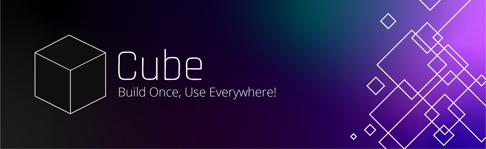

[](https://www.npmjs.com/package/@beforesemicolon/cube)


Cube is a simple and powerful function-oriented framework to create future-proof UI components and web applications.

## Quick Start

```
npm install @beforesemicolon/cube
```

```ts
import {template, register} from '@beforesemicolon/cube';

const MyButton = (props) => {
  template`
    <button type=${props.type}>
      <slot></slot> 
    </button>`;
}

register(MyButton, {
  // defining props by setting default values
  type: "button"
});
```

```html
<my-button>Click me</my-button>
```

You can also import it directly in the browser
```html
<!--insert in the head of the document-->

<!-- Grab the latest version -->
<script src="https://unpkg.com/@beforesemicolon/cube/dist/client.js"></script>

<!-- Or a specific version -->
<script src="https://unpkg.com/@beforesemicolon/cube@0.1.6/dist/client.js"></script>
```
Then you would use it as:
```ts
const {template, register} = window.BFS.Cube;
```

## Documentation

> ###### Table of Content
> - [Create a component](#create-a-component)
> - [Create Elements](#create-elements)
> - [Props](#props)
> - [Component Options](#component-options)
> - [Lifecycles](#lifecycles)
> - [State](#state)
> - [Events](#events)
> - [Host](#host)
> - [Conditional Render](#conditional-render)
> - [Conditional Attributes](#conditional-attributes)
> - [Repeating/listing content](#repeatinglisting-content)
> - [Styling](#styling)

### Create a component
Cube components are simply functions that you register as web components although not every component needs to be
a web component.

```js
const MyButton = () => {}; // valid component

register(MyButton)
```

The name of the function must be two part camel-cased. This is because Cube will turn it into a kebab-cased
[valid html web component name](https://html.spec.whatwg.org/multipage/custom-elements.html#valid-custom-element-name). Therefore, the above button can be used like:

```html
<my-button></my-button>
```

But it will not render anything because we haven't defined its template body. To do that we use the
`template` function.

```js
const MyButton = () => {
  template`<button>my button</button>`
};

register(MyButton)
```

Cube template is based on [@bfs/html](https://www.npmjs.com/package/@beforesemicolon/html) , and it is a powerful
reactive templating system that does not everything you need for templating. 

Check this amazing [Todo App](https://stackblitz.com/edit/web-platform-lvonxr?file=app.js) built just with this templating library.

### Create Elements
Cube elements are simply `html` instances. Bellow are valid elements:

```js
const Button = html`<button>my button</button>`;
const ButtonFn = (props) => html`<button type="${props.type}">${props.content}</button>`;
```

They don't need to be registered and can be used by any component or rendered directly in the DOM:

```js
Button.render(document.body)
Button({type: "button", content: "click me"}).render(document.body)
```

To learn more about Cube template check [@bfs/html docs](https://www.npmjs.com/package/@beforesemicolon/html)
which Cube is built on.

### Props
Props are simply attributes that the component tag will receive or that the element will take. The value of
these props can be anything. 

A component only becomes aware of attributes when you define prop defaults when registering a component.

```ts
const MyButton = (props) => {
  template`
    <button attr.disabled="${props.disabled}">
      <slot></slot>
    </button>`;
};

register(MyButton, {
    disabled: false,
})
```

One thing to keep in mind is the data type, especially when you plan to 
set these attribute values when using the `.html` file. Bellow is an example
of how to pass a JSON data to an element in a HTML file using single quotes to wrap the whole thing. 

If this is how you plan to use the tag, JSON string is the most complex data representation you can use.

```html
// index.html

<todo-item data='{"name": "sample", "status": "pending"}'></todo-item>
```

If the component tag will be used only inside other components, it does not matter how the data look like, but
you should always aim for simple data representations.

```ts
const TodoApp = () => {
    const todos = [];
    
    template`
      <todo-item data="${todos[0]}"></todo-item>
      <todo-item data="${todos[1]}"></todo-item>
      <todo-item data="${todos[2]}"></todo-item>
    `
}
```

Recommended would be to split the data into their primitive values instead like native HTML.

```html
// index.html

<todo-item name="sample" status="pending"></todo-item>
```

### Component Options
Web components are rendered with [shadow root](https://developer.mozilla.org/en-US/docs/Web/API/Element/shadowRoot) in 
[open mode](https://developer.mozilla.org/en-US/docs/Web/API/ShadowRoot/mode). Cube allows you to change these options:
- [mode](https://developer.mozilla.org/en-US/docs/Web/API/ShadowRoot/mode): 'open', 'closed' or 'none'
- [delegatesFocus](https://developer.mozilla.org/en-US/docs/Web/API/ShadowRoot/delegatesFocus): 'true' or 'false'

```ts
register(MyButton, {
    disabled: false,
}, {
  // the none value is valid to Cube only and 
  // it means to render component without shadow root
  mode: 'none',
  delegatesFocus: true
})
```

### Lifecycles
Cube has few lifecycle functions:
- `onMount`: Executes when component is added to the DOM
- `onUpdate`: Executes when component props change either by attributes or property change.
- `onDestroy`: Executes when component is removed to the DOM
- `onAdoption` Executes when component is moved from one document to another. For example, from an iframe document to the page document.

```js
const MyButton = () => {
  onMount(() => {
    console.log('mounted');
  })
  
  // called only after component is mounted
  // any prop event while component is unmounted is ignored
  onUpdate((propName, newValue, oldValue) => {
    console.log('prop updated', propName, newValue, oldValue);
  })
  
  onDestroy(() => {
    console.log('unmounted');
  })
  
  onAdoption(() => {
    console.log('mouted on a different document');
  })
};
```

### State
There is no real concept of state in Cube. Any data used in the template is checked for change
when there is an update. 

By default, any data in the template is considered static data:

```ts
const CounterApp = () => {
	const count = 0; // static data
	
	template`<span>${count}</span>`;
}
```

To define dynamic data you should use functions which are called in the template
whenever there is an update.

```ts
const CounterApp = () => {
    let count = 0;
    
    const countUp = () => {
        count += 1;
        temp.update(); // tell the DOM to update to catch the count change
    }
    
    // tell template count will change
    var temp = template`
      <span>${() => count}</span>
      <button onclick="${countUp}">count</button>
    `;
}
```

However, this is quite messy. Therefore, Cube gives you `state` that handles all that for you:

```ts
const CounterApp = () => {
    // get a getter and a setter functions for a value
    let [count, updateCount] = state(0);
    
    const countUp = () => {
      updateCount(count() + 1)
    }
        
    var temp = template`
      <span>${count}</span>
      <button onclick="${countUp}">count</button>
    `;
}
```

The `state` will automatically trigger DOM update on changes but, it should not be used for everything.
You can still keep data as dynamic data and have a state that when changed will trigger DOM update causing 
everything else to be considered.

### Events
Cube is event driven and that's why you should not pass function as props. Function as props are just callbacks
and with Cube, any component should be able to listen to another regardless of hierarchy via events.

To listen to an event, you set an attribute on the element tag itself starting with `on` followed by the
name of the event all lowercase to match the native HTML pattern. The name of the event can be any
custom event that particular component dispatches or any [native HTML element events](https://developer.mozilla.org/en-US/docs/Web/Events).

```ts
const TextInput = () => {
    const dispatch = eventDispatch();
    
    const onChange = (event) => {
      dispatch('changed', event.target.value)
    }
    
    template`
      <input value=${props.value} type=${props.type} onchange="${onChange}"/>
    `;
}
```

The `eventDispatch` helper will return a function you can call with the name of the event and data
you want to pass with this event. All this will trigger a [Customer](https://developer.mozilla.org/en-US/docs/Web/API/CustomEvent/CustomEvent)
with correct data details.

### Host
When you create a web component you get a HTML tag you can use. In case you want to access it for
any reason, Cube exposes a `host` helper that will provide you with that instance.

```js
const MyButton = () => {
  const btn = host(); // returns HTMLElement instance of my-button tag
};
```

### Conditional Render
Again, because everything is function, conditional rendering is as simple as a function with a ternary:

```ts
const TodoStatus = (props) => {
    template`
      ${props.status() === "pending" 
        ? html`<span class="pending">Pending</span>` 
        : html`<span class="done">Done</span>`
      }
    `
}
```

However, you need to remember that such function is called whenever there is a change and will produce
new instances of the html to be rendered. This might not be what you want as it forces new DOM creation.

To optimal way to do it is to have variable with those elements and swap them on render updates.

```ts
const TodoStatus = (props) => {
    const pendingIndicator = html`<span class="pending">Pending</span>`;
    const comleteIndicator = html`<span class="done">Done</span>`;
    
    template`
      ${props.status() === "pending" 
        ? pendingIndicator
        : comleteIndicator
      }
    `
}
```

But Cube exposes a `when` helper which does all these by default. [Learn more about it](https://www.npmjs.com/package/@beforesemicolon/html#when)

```ts
const TodoStatus = (props) => {
    template`
      ${when(props.status() === "pending",
        html`<span class="pending">Pending</span>`,
        html`<span class="done">Done</span>`
      )}
    `
}
```

### Conditional Attributes
Cube handles conditional attributes by prefixing any attributes with `attr` and providing a condition.
[Learn more](https://www.npmjs.com/package/@beforesemicolon/html#the-attr-attribute)

```ts
const MyButton = () => {
    const ctaButton = () => props.variant() === 'cta';

    template`
      <button
        // only adds disabled attribute when disabled value is TRUE
        attr.disabled="${props.disabled}" 
        
        // adds class of 'cta' when variant is 'cta'
        attr.class.cta="${ctaButton}" 
        
        // adds orange background when cta button variant
        attr.style="background-color: orange, ${ctaButton}"
        >
        <slot></slot>
      </button>
    `
}
```
### Repeating/listing content
Cube will already optimally handle any array you put in the template.

```ts
const TodoApp = () => {
    const items = ["item-1", "item-2", "item-3"];
    
    template`${items}`; // renders item-1item-2item-3
}
```

You may also have a list of html instances.

```ts
const TodoApp = () => {
    const items = [
        html`<span>item-1</span>`,
        html`<span>item-2</span>`,
        html`<span>item-3</span>`,
    ];
    
    template`${items}`;
}
```

But when it comes to composing lists and dynamic data Cube exposes the `repeat` helper
that handles everything for you. [Learn more](https://www.npmjs.com/package/@beforesemicolon/html#repeat)

```ts
const TodoApp = () => {
    template`${repeat(todos, item => html`<span>${item.name}</span>`)}`;
}
```

### Styling
Cube allows you to attach style to your components when you register them. Style is simply a function
that returns a CSS string or object. The style is only render once but once Cube understands you use the props
in your style, it gets updated with every prop change.

```ts
const MyButtonStyle = (props) => {
  return {
    ":host": {
        button: {
          all: "unset",
          background: "#222",
          color: "#fff",
          padding: "8px 20px",
          borderRadius: 3,
          opacity: props.disabled() ? "0.1" : "1"
        }
    }
  }
}
```

Then you just need to tell Cube which style to use:

```ts
const MyButton = (props) => {
  ...
};

register(MyButton, {
    disabled: false,
}, MyButtonStyle) // provide the style
```

You may also return a CSS string but it does not support nested style:

```ts
const MyButtonStyle = (props) => {
  return `
    // the style tag is not needed but it helps IDEs syntax highlight CSS
    <style> 
      :host button {
        all: unset;
        background: #222;
        color: #fff;
        border-radius: 3px;
        opacity: ${props.disabled() ? "0.1" : "1"}
      }
    </style>
  `
}
```

You may also provide a stylesheet link which is perfect if you have external stylesheets:

```ts
const MyButtonStyle = () => {
  return `<link rel="stylesheet" href="./my-button.css">`;
}
```


